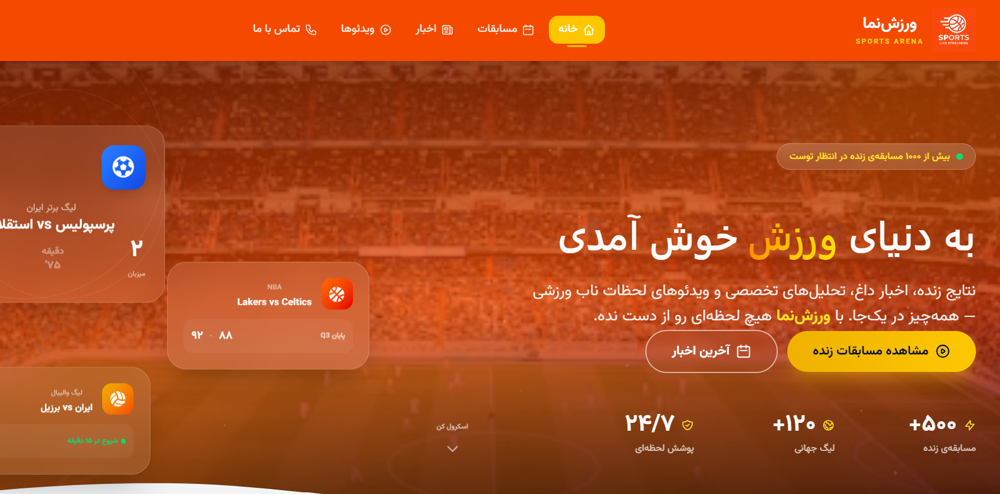

# 🏆 ورزش‌نما – پلتفرم تماشای فیلم و مسابقات ورزشی

یک وب‌سایت زیبا، واکنش‌گرا و سریع برای تماشای آنلاین مسابقات و ویدیوهای ورزشی با قابلیت جستجو، فیلتر کردن و تجربه‌ای روان در تمام دستگاه‌ها.



## 🎯 امکانات

- 📺 **پخش آنلاین:** تماشای مسابقات ورزشی و هایلایت‌ها
- 🔍 **جستجوی پیشرفته:** فیلتر بر اساس ورزش، لیگ یا تیم
- 📱 **واکنش‌گرا:** طراحی بهینه برای موبایل، تبلت و دسکتاپ
- ⚡ **عملکرد بالا:** بارگذاری فوق‌سریع با Vite
- 🧩 **معماری ماژولار:** کامپوننت‌های استاندارد با TypeScript
- 🎨 **طراحی مدرن:** رابط کاربری جذاب با Tailwind CSS

## 🛠 تکنولوژی‌های استفاده‌شده

| تکنولوژی | کاربرد |
| :--- | :--- |
| [React](https://react.dev) | کتابخانهٔ اصلی رابط کاربری |
| [TypeScript](https://www.typescriptlang.org) | توسعهٔ ایمن و تایپ‌سیف |
| [Vite](https://vitejs.dev) | ابزار ساخت و توسعه |
| [Tailwind CSS](https://tailwindcss.com) | استایل‌دهی مدرن |
| [React Router](https://reactrouter.com) | مسیریابی سمت کاربر |
| [Axios](https://axios-http.com) | ارتباط با API |

## 🚀 دموی زنده

برای مشاهده پروژه، روی لینک زیر کلیک کنید:
🔗 [https://sports-stream-hub-rutf.vercel.app/](https://sports-stream-hub-rutf.vercel.app/)

## 📦 راه‌اندازی در سیستم شخصی

### پیش‌نیازها
- Node.js (نسخه ۱۸ یا بالاتر)
- npm یا yarn

### مراحل نصب و اجرا

۱. کلون کردن مخزن:
```bash
git clone https://github.com/MobinDe/sports-stream-hub.git
cd sports-stream-hub
۲. نصب وابستگی‌ها:

bash
npm install
# یا
yarn
۳. اجرای پروژه در محیط توسعه:

bash
npm run dev
# یا
yarn dev